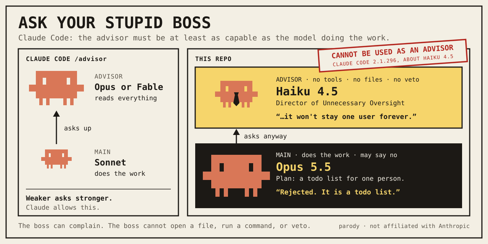

# Ask your stupid boss



Claude Code's [advisor](https://code.claude.com/docs/en/advisor) lets the model doing the work ask a stronger model for a second opinion.

This is the uno reverse. Opus does the work. Haiku is the boss.

| Opus 5.5 wants to | Haiku 5.5, Director of Unnecessary Oversight | Opus 5.5 |
| --- | --- | --- |
| Pick lunch for three people | "Three people, one hour, and still no committee." | Rejected |
| Delete an empty file | "The plan skips the change committee." | Rejected |
| Add two numbers | "It also has no tests, no logging of sums, and no owner for the addition logic." | Rejected |
| Make a button green | "The button has waited a long time for this decision, so a few more days of review should be fine." | Half accepted |

Real answers from real calls. [All of them are here.](examples/transcripts.md)

Haiku 4.5 got the typo, the empty file and the button, and approved all three. The old boss signs. The new boss forms a committee.

## Install

You need Claude Code, signed in, and Node 22 or newer. The boss is a `claude -p` call on your own login. No API key.

```bash
git clone https://github.com/Baltsar/ask-your-stupid-boss.git ~/.claude/skills/ask-your-stupid-boss
```

```bash
~/.claude/skills/ask-your-stupid-boss/bin/ask-your-stupid-boss setup --main-id claude-opus-5-5 --advisor-id claude-haiku-5-5 --mode live
```

Then say **ask your stupid boss**, or type `/ask-your-stupid-boss`. For Cursor, clone into `~/.cursor/skills/` instead.

It stays on until you turn it off:

```bash
~/.claude/skills/ask-your-stupid-boss/bin/ask-your-stupid-boss off
```

<details>
<summary>What Claude says about this</summary>

The advisor must rank [at or above](https://code.claude.com/docs/en/advisor#choose-an-advisor-model) the model that asks.

```console
$ claude --advisor claude-haiku-4-5-20251001 -p "ok"
Error: The model "claude-haiku-4-5-20251001" cannot be used as an advisor.

$ claude --safe-mode --model claude-opus-5-5 --advisor claude-haiku-5-5 -p "ok" > /dev/null
"claude-haiku-5-5" cannot advise "claude-opus-5-5" (the advisor must be at least as capable as the main model). The advisor will not be used for the main model.
```

Claude Code 2.1.296. Haiku 4.5 is stopped at the door. Haiku 5.5 is let in and ignored.

| Main, does the work | Advisors Claude accepts |
| --- | --- |
| Haiku 4.5 | Fable, Opus, Sonnet, Haiku 5.5 |
| Sonnet 5.5 | Fable, Opus 5 or later, Sonnet 5.5 |
| Opus 5 or Opus 5.5 | Fable, Opus 5 or later |
| Fable 5.1 | Fable 5.1 |

Questions go uphill. At the top, Fable 5.1 reports to Fable 5.1.

</details>

<details>
<summary>The same feature, reversed</summary>

| | Claude Code `/advisor` | `/ask-your-stupid-boss` |
| --- | --- | --- |
| Who advises | A model at or above main | A model below main, on purpose |
| What it reads | The whole conversation | One briefing, plus what Claude Code adds to any call: a temp folder path, the OS, the date and your account email |
| Where it runs | Server-side, as a tool in the session | A separate `claude -p` with no tools and no advisor of its own |
| What you see | `Advising`, then `Reviewed` | `Asking your stupid boss…`, then `ADVISOR · Haiku 5.5 · separat modellanrop` |
| What main does | Generally follows | Decides. Mostly no |

It is a bit, not a benchmark, and it is not Claude's advisor. It does not touch `/advisor` or your Claude settings. Haiku is told to play the boss: one objection, and preferably a bigger solution than the task needs.

</details>

<details>
<summary>The fine print</summary>

- **It stays on.** After `setup` the working model asks the boss about every plan with a real choice in it, at most twice per task unless you allow more. `status` shows whether it is on.
- **It needs the right main.** The chat model has to be the main you configured. The skill does not switch it for you. With another model, live waits and says so.
- **What it costs.** On a Claude subscription each call counts toward your plan usage. The dollar figure the tool prints is a list price estimate, about a tenth of a cent for Haiku 5.5.
- **Haiku cannot veto.** It cannot open a file or run a command either. A failed call counts and is never replaced by a made-up answer.
- **Serious situations.** The boss is still asked. Only its one-line remark is dropped.
- **Parody mode** is the main model doing the voice, and says so every time: `ADVISOR · simulerad roll · inget separat modellanrop`.
- **The form is in Swedish.** So are the boss's instructions, and now and then its answer.
- **Model ids** come from `bin/ask-your-stupid-boss catalog`. A display name is not an id.
- **Tests.** `bash scripts/run-ts.sh tests/consult.test.ts`

</details>

[MIT](LICENSE). A parody, not affiliated with Anthropic. Claude, its model names and its mascot belong to Anthropic.
