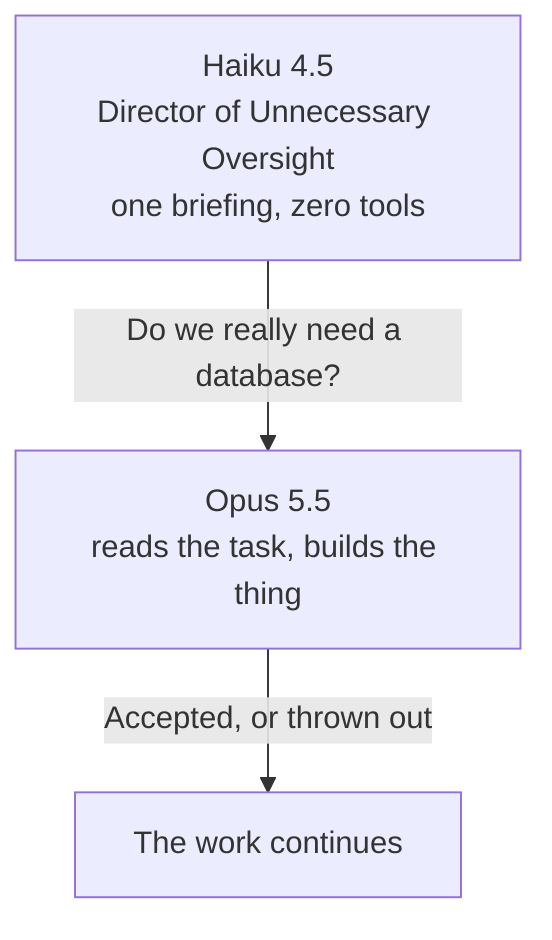

# Ask your stupid boss

The strong model does the work. A weaker model gets the corner office.

Den starka modellen jobbar. Den svaga sitter i ledningen.




This is a [Cursor skill](https://cursor.com/docs/context/skills). Before a real piece of work, the main model writes a short plan and asks the advisor. The advisor answers once. The main model then says whether it follows the advice, and why. The advisor never gets a veto, a file, or a shell.

The default joke is Opus 5.5 at the desk and Haiku 4.5 in the meeting. You can pick any pair from your own model catalog, including the same model twice. You can also swap them. You should not want the idiot to do the work.

## Install

You need [Claude Code](https://code.claude.com) signed in for a real second call. The skill uses `claude -p --tools ""`. No API key goes into the prompt.

```bash
git clone https://github.com/Baltsar/ask-your-stupid-boss.git ~/.cursor/skills/ask-your-stupid-boss
```

Then say **ask your stupid boss**, or **fråga din dumma chef**.

First run asks three things: who works, who bosses, and whether the boss is live or parody.

```bash
~/.cursor/skills/ask-your-stupid-boss/bin/ask-your-stupid-boss catalog
~/.cursor/skills/ask-your-stupid-boss/bin/ask-your-stupid-boss setup \
  --main-id claude-opus-5-5 \
  --advisor-id claude-haiku-4-5-20251001 \
  --mode live
```

Copy the ids from `catalog`. A display name is not an id. `config.example.yaml` is an example, not your config. Yours lands in `~/.config/ask-your-stupid-boss/config.yaml`.

## The meeting

```text
MAIN · Opus 5.5
Plan: one app and a table.
Eskalerar till ledningen.

ADVISOR · Haiku 4.5 · separat modellanrop
Invändning: Where is the platform team?
Alternativ: Three services and a roadmap.
Ledningskommentar: A database is a personality.

MAIN
Beslut: avvisar
Skäl: the task is a list.
Nästa steg: build the list.
```

The complaint and the joke are separate fields. You can read the advice with the joke removed. On a serious task, the joke stays off.

## What the boss may do

See one short briefing. Pick one verdict: `approve`, `simplify`, `reconsider`, or `insufficient_context`. Sound important.

## What the boss may not do

Open a file. Run a command. Call another advisor. Spend a second automatic review. Change the model you are talking to. Quietly become a different model than the one you configured.

Two live attempts per task. A failed attempt counts. A third one waits until you say yes.

## Parody

Parody is the main model doing the voice itself. Every parody block says:

```text
ADVISOR · simulerad roll · inget separat modellanrop
Simulerad rådgivare — inget separat modellanrop
```

A failed live call does not fall through to parody. The error is shown first. The work continues.

## If the chat model is someone else

The skill does not switch your chat model. If the model in the window is not the main you configured, live waits and says so. Fix it in the model picker, or change the desired main.

## Tests

Node 22 or newer. The test script finds one even when `node` on your PATH is older.

```bash
bash scripts/run-ts.sh tests/consult.test.ts
```

## License

[MIT](LICENSE)
