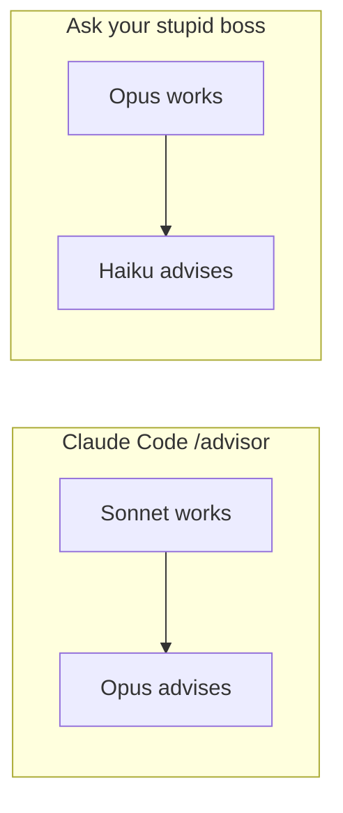

# Ask your stupid boss

Claude Code's [advisor](https://code.claude.com/docs/en/advisor) pairs the model doing the work with a **stronger** one. The advisor has to outrank main. [Haiku 4.5 can call an advisor. Haiku 4.5 cannot be one.](https://code.claude.com/docs/en/advisor#choose-an-advisor-model)

This skill asks it anyway.

Den starka modellen jobbar. Den svaga sitter i ledningen. Claudes egen tabell säger nej.


## The row Claude deleted

Advisor calls happen inside Claude Code with `/advisor`. The normal pairs go uphill:

| Main, does the work | Advisor, must be at least as strong |
| --- | --- |
| Haiku | Opus |
| Sonnet | Opus or Fable |
| Opus | Opus or Fable |

If the advisor ranks below main, Claude Code warns that the model `cannot advise` and does not attach it. Haiku 4.5 is refused outright.

| This skill | |
| --- | --- |
| Main | Opus 5.5, does the work |
| Advisor | Haiku 4.5, Director of Unnecessary Oversight |
| What Claude would say | `cannot advise` |



You do not rebuild this inside Claude Code. `/advisor` will not take the joke. Try it if you want to see the refusal:

```text
/model opus
/advisor haiku
```

Then come back here. The skill runs in Cursor. The live call is a separate, tool-less `claude -p`, not Claude's server-side advisor tool. The boss sees one briefing. The boss does not see your files, your shell, or the rest of the transcript.

## Install

Claude Code has to be signed in, because that is who Haiku answers as. No API key goes into the prompt.

```bash
git clone https://github.com/Baltsar/ask-your-stupid-boss.git ~/.cursor/skills/ask-your-stupid-boss
```

In Cursor, say **ask your stupid boss**. The chat model has to be the main you configured. This skill does not switch it for you. If the window is someone else, live waits and says so.

```bash
~/.cursor/skills/ask-your-stupid-boss/bin/ask-your-stupid-boss catalog
~/.cursor/skills/ask-your-stupid-boss/bin/ask-your-stupid-boss setup \
  --main-id claude-opus-5-5 \
  --advisor-id claude-haiku-4-5-20251001 \
  --mode live
```

Copy the ids from `catalog`. A display name is not an id. On a serious task the joke stays off.

## What Claude shows, and what this shows

Claude's transcript says `Advising`, then `Reviewed`. Press `Ctrl+O` and the stronger model has already read the whole conversation.

This one escalates to management:

```text
MAIN · Opus 5.5
Plan: one app and a table.
Eskalerar till ledningen.

ADVISOR · Haiku 4.5 · separat modellanrop
Invändning: Where is the platform team?
Alternativ: Three services and a roadmap.
Ledningskommentar: A database is a personality.

MAIN
Beslut: avvisar
Skäl: the task is a list.
Nästa steg: build the list.
```

Opus can throw the advice out. Haiku cannot veto, open a file, or hire a subcommittee. Two live attempts per task. A failed call counts, and it does not quietly turn into parody.

Parody is labeled, every time:

```text
ADVISOR · simulerad roll · inget separat modellanrop
Simulerad rådgivare — inget separat modellanrop
```

## Tests

Node 22 or newer.

```bash
bash scripts/run-ts.sh tests/consult.test.ts
```

## License

[MIT](LICENSE)
